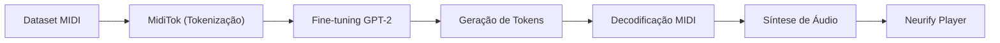

<div align="center">
  

  # Neurify
  ### *Music that never existed.*

  <p align="center">
    <em>An infinite stream of original music, composed by artificial intelligence.</em>
  </p>

  <p align="center">
    
    
    
  </p>

  <p align="center">
    
    
    
    
    
    
  </p>
</div>

---

## 1. Sobre o Neurify

**Neurify — Music that never existed.**

O **Neurify** é uma aplicação experimental de geração musical com Inteligência Artificial, desenvolvida como projeto acadêmico da disciplina de **Redes Neurais e Deep Learning do IBMEC**.

O projeto tem como objetivo explorar o uso de modelos de linguagem baseados na arquitetura **Transformer** para geração de sequências musicais inéditas. A proposta consiste em realizar o **fine-tuning do modelo GPT-2** utilizando datasets de músicas em formato **MIDI**, permitindo que a rede aprenda relações harmônicas, rítmicas e melódicas e gere novas composições a partir de sequências de tokens.

Para complementar o desenvolvimento e a avaliação do modelo, o Neurify apresenta uma interface web inspirada em plataformas modernas de streaming musical, na qual o usuário pode solicitar a geração de uma música, reproduzi-la e gerar uma nova composição ao avançar para a próxima faixa (*Skip*).

Diferentemente de serviços tradicionais de streaming como o Spotify, o Neurify **não depende de um catálogo preexistente**: sua proposta é gerar novas composições sob demanda, acompanhadas de identidades visuais procedurais exclusivas para cada sequência.

---

## 2. Contexto Acadêmico

| Campo | Identificação |
| :--- | :--- |
| **Instituição** | IBMEC |
| **Disciplina** | Redes Neurais e Deep Learning |
| **Projeto** | Neurify |
| **Área** | Inteligência Artificial Generativa / Geração Musical Simbólica |
| **Modelo Base** | GPT-2 (*Fine-tuning* em sequências MIDI tokenizadas) |

---

## 3. Objetivos do Projeto

- Investigar a aplicação de arquiteturas **Transformer** (especificamente o modelo autorregressivo GPT-2) na geração de sequências musicais simbólicas.
- Realizar o **fine-tuning do GPT-2** utilizando dados musicais tokenizados a partir de arquivos MIDI.
- Explorar o pré-processamento, quantização e representação de arquivos MIDI em vocabulários discretos com **MidiTok**.
- Avaliar a capacidade do modelo de capturar estruturas, progressões e padrões musicais coerentes.
- Desenvolver um pipeline ponta a ponta de geração de tokens, decodificação MIDI e síntese de áudio.
- Demonstrar a experiência de consumo de música generativa sob demanda por meio de uma aplicação web interativa e responsiva.

---

## 4. Como Funciona a Geração Musical

O pipeline arquitetado para o Neurify conecta o processamento simbólico de dados MIDI à reprodução de áudio na interface web:



1. **Dataset MIDI & Tokenização (`MidiTok`):** Arquivos MIDI são convertidos em sequências discretas de eventos musicais (notas, velocidades, durações e deslocamentos temporais).
2. **Fine-tuning (`GPT-2`):** O modelo GPT-2 é ajustado sobre o vocabulário musical para prever o próximo token dado o contexto anterior.
3. **Inferência e Decodificação:** A cada solicitação do usuário na interface, uma nova sequência de tokens é amostrada, reconvertida em estrutura MIDI e renderizada em arquivo de áudio.
4. **Neurify Player:** O frontend recebe os metadados e o fluxo de áudio, gerando simultaneamente uma capa artística procedural em HTML5 Canvas baseada na semente (*seed*) e nos parâmetros da faixa.

---

## 5. Tecnologias Utilizadas

### Inteligência Artificial e Processamento Musical *(Pipeline de Modelagem / Backend Planejado)*
- **Python** — Linguagem base para o pipeline de dados, treinamento e API de inferência.
- **PyTorch** — Framework de Deep Learning para treinamento e inferência do modelo.
- **Hugging Face Transformers** — Carregamento, configuração e *fine-tuning* do modelo `GPT-2`.
- **MidiTok** — Tokenização de arquivos MIDI para modelos baseados em Transformer.
- **MIDI** — Representação simbólica estruturada de eventos musicais.

### Aplicação Web *(Frontend Implementado)*
- **React 19 + TypeScript** — Arquitetura de componentes fortemente tipada.
- **Vite 6** — Bundler e ambiente de desenvolvimento de alta performance.
- **Tailwind CSS 4** — Estilização utilitária customizada com paleta proprietária.
- **Motion (`framer-motion`)** — Transições de tela, microinterações e animações de estado.
- **Lucide React** — Iconografia minimalista.
- **HTML5 Audio API & Canvas 2D** — Reprodução nativa de áudio e geração procedural de capas e ondas neurais.

---

## 6. Estrutura do Repositório

```text
neurify/
├── public/
│   ├── audio/                    # Faixas locais de demonstração para o modo MOCK
│   ├── _redirects                # Configuração de roteamento estático (Cloudflare Pages)
│   └── favicon.svg               # Ícone vetorial do Neurify
├── src/
│   ├── assets/                   # Recursos estáticos internos
│   ├── components/
│   │   ├── AlbumArtwork.tsx      # Arte generativa procedural 1:1 em Canvas por faixa
│   │   ├── GenerationState.tsx   # Visualizador animado das etapas de síntese neural
│   │   ├── Logo.tsx              # Marca gráfica minimalista com ondas e nós neurais
│   │   ├── MusicControls.tsx     # Controles Play/Pause, Skip (nova geração) e Volume
│   │   ├── NeuralVisual.tsx      # Composição procedural interativa da tela inicial
│   │   └── ProgressBar.tsx       # Barra de progresso interativa com suporte a teclado
│   ├── hooks/
│   │   └── useMusicPlayer.ts     # Gerenciamento do HTML5 Audio, estados e AbortController
│   ├── pages/
│   │   ├── Welcome.tsx           # Tela 01 — Experiência de entrada (Landing)
│   │   └── Player.tsx            # Tela 02 — Player de streaming generativo
│   ├── services/
│   │   └── musicService.ts       # Camada desacoplada de serviço (Modos MOCK e API)
│   ├── styles/
│   │   └── index.css             # Tokens visuais, tipografia e utilitários globais
│   ├── types/
│   │   └── music.ts              # Contratos TypeScript para faixas, geração e serviço
│   ├── App.tsx                   # Orquestração entre telas e transições
│   └── main.tsx                  # Ponto de entrada da aplicação React
├── .env.example                  # Variáveis de ambiente suportadas
├── index.html                    # Documento base e carregamento tipográfico
├── package.json                  # Scripts e dependências do projeto
├── tsconfig.json                 # Configuração do compilador TypeScript
└── vite.config.ts                # Configuração de build Vite
```

---

## 7. Como Executar Localmente

### Pré-requisitos
- **Node.js** `>= 18.x` (recomendado `20.x` ou `22.x`)
- **npm** `>= 9.x`

### Passo a passo

1. **Instale as dependências do projeto:**
   ```bash
   npm install
   ```

2. **(Opcional) Configure as variáveis de ambiente:**
   Por padrão, a aplicação executa automaticamente no modo de demonstração (`mock`). Caso deseje customizar, copie o arquivo `.env.example` para `.env`:
   ```bash
   cp .env.example .env
   ```

3. **Inicie o servidor de desenvolvimento:**
   ```bash
   npm run dev
   ```
   Acesse o endereço exibido no terminal (geralmente `http://localhost:5173`).

4. **Validação de tipos e build de produção:**
   ```bash
   npm run lint
   npm run build
   npm run preview
   ```

### Publicação na Cloudflare Pages
O projeto é 100% compatível com hospedagem estática na **Cloudflare Pages**:
- **Build command:** `npm run build`
- **Build output directory:** `dist`
- **Node.js version:** `20` ou `22`

---

## 8. Status de Desenvolvimento

> [!IMPORTANT]
> **Modo de Demonstração Ativo (`MOCK`):** Nesta etapa do projeto, o modelo GPT-2 ainda não está conectado em tempo real ao frontend. A interface opera em modo `MOCK` (identificado discretamente na aplicação como `DEMO PREVIEW` / `[MOCK AUDIO]`), utilizando composições locais de demonstração e simulando as etapas de geração para validar toda a experiência de usuário e arquitetura do player.

### Implementado (Frontend & Arquitetura de Interface)
- [x] **Tela 01 (Welcome):** Composição procedural interativa em Canvas, tipografia editorial e acionamento imediato do fluxo generativo.
- [x] **Tela 02 (Music Player):** Player responsivo (mobile-first e desktop) com controles de reprodução, busca interativa (*seek*), volume e geração contínua ao avançar (*Skip*).
- [x] **Arte Procedural por Faixa:** Cada música gerada recebe uma semente única que renderiza padrões geométricos e harmônicos distintos em proporção 1:1.
- [x] **Camada de Serviço Desacoplada (`musicService.ts`):** Interface pronta para alternar entre o modo `mock` e o modo `api` via variável de ambiente (`VITE_MUSIC_SERVICE_MODE=api`), sem necessidade de reescrever componentes visuais.
- [x] **Controle de Concorrência e Acessibilidade:** Cancelamento de requisições em andamento via `AbortController`, limpeza de recursos de áudio, suporte a teclado e respeito a `prefers-reduced-motion`.

### Planejado (Pipeline de IA & Integração Backend)
- [ ] Pré-processamento do dataset MIDI e tokenização com `MidiTok`.
- [ ] Treinamento e *fine-tuning* do modelo `GPT-2` em PyTorch / Hugging Face.
- [ ] Avaliação qualitativa e quantitativa das sequências musicais geradas.
- [ ] Implementação do servidor de inferência e síntese de áudio em Python (`FastAPI`).
- [ ] Conexão do frontend ao endpoint de inferência real (`VITE_MUSIC_SERVICE_MODE=api`).

---

## 9. Licença e Créditos

- **Contexto:** Projeto acadêmico desenvolvido no **IBMEC** para a disciplina de **Redes Neurais e Deep Learning**.
- **Licença:** A ser definida pelos autores do projeto em etapa posterior.
