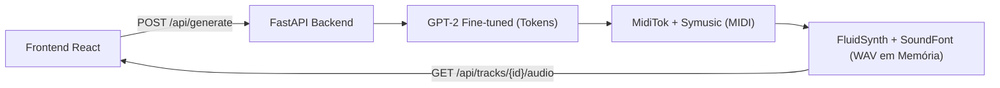

<div align="center">
  

  # Neurify
  ### *Music that never existed.*

  <p align="center">
    <em>An infinite stream of original music, composed by artificial intelligence.</em>
  </p>

  <p align="center">
    
    
    
  </p>

  <p align="center">
    
    
    
    
    
  </p>
</div>

---

## 1. Sobre o Neurify

**Neurify — Music that never existed.**

O **Neurify** é uma aplicação experimental de geração musical com Inteligência Artificial, desenvolvida como projeto acadêmico da disciplina de **Redes Neurais e Deep Learning do IBMEC**.

O projeto explora o uso de modelos de linguagem baseados na arquitetura **Transformer** para geração de sequências musicais inéditas. A proposta consiste em realizar o **fine-tuning do modelo GPT-2** utilizando datasets de músicas em formato **MIDI**, permitindo que a rede aprenda relações harmônicas, rítmicas e melódicas e gere novas composições a partir de sequências de tokens.

Seguindo o conceito *"The music can be only played once, so enjoy the ride"*, as composições geradas são **efêmeras**: o áudio sintetizado permanece apenas em memória durante a reprodução atual e é descartado assim que o usuário avança (*Skip*) para uma nova composição.

---

## 2. Contexto Acadêmico

| Campo | Identificação |
| :--- | :--- |
| **Instituição** | IBMEC |
| **Disciplina** | Redes Neurais e Deep Learning |
| **Projeto** | Neurify |
| **Área** | Inteligência Artificial Generativa / Geração Musical Simbólica |
| **Modelo Base** | GPT-2 (*Fine-tuning* em sequências MIDI tokenizadas) |
| **Execução** | 100% Local (Frontend React + Backend FastAPI) |

---

## 3. Arquitetura e Fluxo de Geração Musical

O pipeline local do Neurify conecta o frontend React à API Python (`FastAPI`), que executa a geração fora da thread principal e sintetiza o áudio em memória:



1. **Solicitação do Frontend:** O botão *"Generate your first track"* ou o botão *Skip* solicita uma nova composição via `POST /api/generate`.
2. **Inferência do GPT-2:** O serviço desacoplado (`model_service.py`) executa em uma worker thread dedicada (limitada a 1 geração por vez) para não bloquear consultas de status (`GET /api/generations/{id}`).
3. **Decodificação MIDI (`MidiTok` + `Symusic`):** Os tokens gerados são decodificados com a mesma configuração do treinamento.
4. **Síntese de Áudio Efêmera (`FluidSynth`):** O MIDI temporário é convertido para WAV com `FluidSynth` e mantido apenas em memória RAM para reprodução única.
5. **Reprodução no Player:** O frontend recebe os metadados e reproduz o stream de áudio (`GET /api/tracks/{id}/audio`), acompanhado de arte generativa procedural em HTML5 Canvas.

---

## 4. Endpoints do Backend Local

| Método | Rota | Descrição |
| :--- | :--- | :--- |
| `GET` | `/api/health` | Retorna o estado do servidor, modo ativo (`MOCK` ou `REAL`) e se o modelo GPT-2 está carregado. |
| `POST` | `/api/generate` | Inicia a geração de uma música inédita (controle de concorrência de 1 execução por vez) e retorna o `id` da geração. |
| `GET` | `/api/generations/{id}` | Retorna o status (`pending`, `generating`, `completed`, `failed`), progresso, metadados e URL do áudio. |
| `GET` | `/api/tracks/{id}/audio` | Disponibiliza o stream de áudio (WAV) da faixa ativa em memória (com suporte a HTTP `Range`). |
| `DELETE` | `/api/generations/{id}` | Cancela uma geração em andamento e libera o slot de execução. |

---

## 5. Estrutura do Repositório

```text
neurify/
├── backend/
│   ├── checkpoints/              # Diretório local para pesos do GPT-2 e config do MidiTok (ignorado no Git)
│   ├── soundfonts/               # Diretório local para arquivos SoundFont .sf2 (ignorado no Git)
│   ├── config.py                 # Configurações locais, caminhos e origens CORS permitidas
│   ├── main.py                   # Servidor FastAPI, rotas REST e controle de ciclo de vida
│   ├── model_service.py          # Camada desacoplada do GPT-2, MidiTok, FluidSynth e modo MOCK
│   ├── schemas.py                # Contratos Pydantic da API
│   ├── requirements.txt          # Dependências Python do backend
│   └── .env.example              # Exemplo de variáveis de ambiente do backend
├── public/
│   ├── audio/                    # Faixas WAV de demonstração utilizadas enquanto em modo MOCK
│   └── favicon.svg               # Ícone vetorial do Neurify
├── src/
│   ├── components/               # Componentes visuais (AlbumArtwork, GenerationState, MusicControls, etc.)
│   ├── hooks/
│   │   └── useMusicPlayer.ts     # Gerenciamento do HTML5 Audio, estados de geração e tratamento de erros
│   ├── pages/
│   │   ├── Welcome.tsx           # Tela 01 — Experiência de entrada
│   │   └── Player.tsx            # Tela 02 — Player de streaming generativo
│   ├── services/
│   │   └── musicService.ts       # Cliente HTTP integrado ao backend FastAPI via VITE_API_URL
│   ├── types/
│   │   └── music.ts              # Contratos TypeScript
│   ├── App.tsx                   # Orquestração entre telas e transições
│   └── main.tsx                  # Ponto de entrada React
├── .env.example                  # Variável VITE_API_URL=http://localhost:8000
├── package.json                  # Scripts e dependências do frontend
└── vite.config.ts                # Configuração Vite
```

---

## 6. Guia de Execução Local (Apresentação Acadêmica)

### 6.0. Instalação rápida no Windows (recomendada)

1. Clone o repositório e entre na branch com o modelo real:
   ```powershell
   git clone -b ewerton/ap2-transfer-learning https://github.com/ewerside/Neurify.git
   ```
2. Baixe o modelo treinado: a pasta `gpt2_pretreinado` (ou só o `model.safetensors`, 345 MB) que o grupo compartilhou no Google Drive. Deixe em `Downloads`, sem renomear. Os pesos não ficam no GitHub por causa do tamanho.
3. Clique duas vezes em **`Preparar-Neurify.bat`**, na raiz do repositório. Ele:
   - copia o modelo para `backend/checkpoints/gpt2-midi/`, com a configuração e o tokenizador que estão em `backend/modelo_config/`;
   - baixa do VGMusic os MIDIs do conjunto de teste (lista em `backend/modelo_config/prompts_teste.txt`), usados como começo das músicas;
   - baixa o SoundFont `FluidR3_GM.sf2` (licença MIT), o mesmo do notebook, da [release `soundfont-v1`](https://github.com/ewerside/Neurify/releases/tag/soundfont-v1);
   - baixa o FluidSynth para Windows dentro de `backend/tools/`, sem mexer no `PATH`;
   - cria o `backend/.env` em modo `auto`, o ambiente Python (`backend/.venv`) e roda o `npm install`;
   - instala Python e Node pelo `winget` se faltarem (pede confirmação);
   - abre o backend, confere `"mode": "REAL"` em `/api/health`, gera uma música de teste e abre o player.
4. Nas próximas vezes, clique duas vezes em **`Iniciar-Neurify.bat`**.

Se o Windows mostrar "O Windows protegeu o computador", clique em "Mais informações" e "Executar assim mesmo". A instalação manual, para qualquer sistema, está a seguir.

### 6.1. Instalação das Dependências Python (Backend)

1. Acesse a pasta `backend/` e crie um ambiente virtual Python (`Python >= 3.10`):
   ```bash
   cd backend
   python -m venv .venv
   ```

2. Ative o ambiente virtual:
   - **Windows (PowerShell):**
     ```powershell
     .\.venv\Scripts\Activate.ps1
     ```
   - **Linux / macOS:**
     ```bash
     source .venv/bin/activate
     ```

3. Instale as dependências:
   ```bash
   pip install -r requirements.txt
   ```

### 6.2. Instalação do Sintetizador MIDI (`FluidSynth`) e `SoundFont`

Para converter os arquivos MIDI gerados pelo modelo em áudio WAV no modo real:

1. **Instale o executável do FluidSynth no sistema operacional:**
   - **Windows:** baixe o `.zip` `win10-x64` da [página de releases do FluidSynth](https://github.com/FluidSynth/fluidsynth/releases), extraia e aponte `NEURIFY_FLUIDSYNTH_BIN` no `backend/.env` para o `bin/fluidsynth.exe` (ou use o `Preparar-Neurify.bat`, que faz isso). Use a versão 2.x; a partir da 2.6, as opções precisam vir antes dos arquivos, e o backend já chama assim.
   - **macOS (Homebrew):**
     ```bash
     brew install fluid-synth
     ```
   - **Ubuntu / Debian:**
     ```bash
     sudo apt-get update && sudo apt-get install -y fluidsynth
     ```
   Verifique se o binário está disponível no `PATH` executando `fluidsynth --version`.

2. **Adicione um arquivo SoundFont (`.sf2`):**
   - Baixe um SoundFont General MIDI. O usado no notebook é o `FluidR3_GM.sf2`, disponível na [release `soundfont-v1`](https://github.com/ewerside/Neurify/releases/tag/soundfont-v1) deste repositório.
   - Salve o arquivo em `backend/soundfonts/default.sf2` (ou configure o caminho em `NEURIFY_SOUNDFONT_PATH` no arquivo `backend/.env`).

### 6.3. Configuração do Caminho do Checkpoint

1. Copie o arquivo de exemplo de variáveis de ambiente do backend:
   ```bash
   cp backend/.env.example backend/.env
   ```
2. Baixe o modelo salvo pelo notebook de treinamento ([MIDI_AP2_GPT2_Chrono_Trigger](https://colab.research.google.com/drive/1LAeftmFJ0Ot10bTrVG5TEsK4Bn4N-Rme), seção 23). No Google Drive de quem rodou o notebook, ele fica em `MIDI_AP2/estilo_chrono_trigger/resultados/gpt2_pretreinado/`. Copie o conteúdo dessa pasta para `backend/checkpoints/gpt2-midi/`. Se tiver só o `model.safetensors`, os outros três arquivos estão em `backend/modelo_config/`:
   ```text
   backend/checkpoints/gpt2-midi/
   ├── config.json              # GPT-2 124M com tabela de 484 tokens
   ├── generation_config.json
   ├── model.safetensors        # pesos após as duas fases de ajuste fino
   ├── tokenizer.json           # MidiTok 3.1.0, REMI, com a mesma configuração do treino
   └── prompts/                 # opcional: MIDIs usados como começo de cada geração
   ```
3. **Opcional, mas recomendado:** copie para `backend/checkpoints/gpt2-midi/prompts/` alguns MIDIs do conjunto de **teste** (os links estão em `backend/modelo_config/prompts_teste.txt`). Cada geração sorteia um deles, usa os dois primeiros compassos como começo, como na seção 21 do notebook, e toca só a continuação criada pelo modelo. Sem essa pasta, a geração começa de um compasso 4/4 vazio.
4. Confira o `backend/.env`:
   ```env
   NEURIFY_EXECUTION_MODE=auto
   NEURIFY_CHECKPOINT_DIR=./checkpoints/gpt2-midi
   NEURIFY_TOKENIZER_CONFIG=./checkpoints/gpt2-midi/tokenizer.json
   NEURIFY_PROMPTS_DIR=./checkpoints/gpt2-midi/prompts
   NEURIFY_SOUNDFONT_PATH=./soundfonts/default.sf2
   ```
   > **Nota:** com `auto`, o backend usa o modelo real quando encontra os pesos, o `tokenizer.json`, o SoundFont e o FluidSynth. Se faltar algo, opera em modo `MOCK` e o `GET /api/health` diz o que está faltando. Com `mock`, usa sempre os áudios de demonstração; com `real`, recusa iniciar sem os arquivos.

### 6.4. Inicialização do Backend (FastAPI)

Com o ambiente virtual ativado dentro da pasta `backend/`:

```bash
cd backend
uvicorn main:app --reload --host 127.0.0.1 --port 8000
```
A API estará disponível em `http://localhost:8000` (documentação interativa Swagger em `http://localhost:8000/docs`).

### 6.5. Inicialização do Frontend (React + Vite)

Em outro terminal, na raiz do repositório:

1. Configure a variável de ambiente do frontend (opcional, pois o padrão já é `http://localhost:8000`):
   ```bash
   cp .env.example .env
   ```
   Conteúdo de `.env`:
   ```env
   VITE_API_URL=http://localhost:8000
   ```

2. Instale os pacotes e inicie o servidor Vite:
   ```bash
   npm install
   npm run dev
   ```
3. Abra `http://localhost:5173` no navegador.

---

## 7. Como Verificar a API e Realizar uma Geração de Teste

### 7.1. Verificar se a API está funcionando (`GET /api/health`)

No terminal (ou navegador), execute:

```bash
curl http://localhost:8000/api/health
```

Resposta esperada (enquanto em modo `MOCK`):
```json
{
  "status": "ok",
  "model_loaded": false,
  "mode": "MOCK",
  "is_generating": false,
  "active_generation_id": null,
  "checkpoint_dir": ".../backend/checkpoints/gpt2-midi",
  "checkpoint_found": false,
  "tokenizer_config_found": false,
  "soundfont_found": false,
  "fluidsynth_available": false,
  "detail": "Operating in MOCK demonstration mode with local audio files..."
}
```

### 7.2. Realizar uma geração de teste via linha de comando

1. **Disparar uma nova geração (`POST /api/generate`):**
   ```bash
   curl -X POST http://localhost:8000/api/generate \
     -H "Content-Type: application/json" \
     -d "{}"
   ```
   Exemplo de retorno:
   ```json
   {
     "id": "gen-1763156000000-a1b2c3",
     "jobId": "gen-1763156000000-a1b2c3",
     "status": "pending",
     "mode": "MOCK",
     "is_mock": true,
     "message": "Composing something new..."
   }
   ```

2. **Consultar o status da geração (`GET /api/generations/{id}`):**
   ```bash
   curl http://localhost:8000/api/generations/gen-1763156000000-a1b2c3
   ```
   Quando `status` for `"completed"`, o JSON conterá o objeto `track` e `audio_url` (ex.: `"/api/tracks/nrf-mock-1a2b3/audio"`).

3. **Testar o stream do áudio gerado (`GET /api/tracks/{id}/audio`):**
   ```bash
   curl -I http://localhost:8000/api/tracks/nrf-mock-1a2b3/audio
   ```
   Retorna `HTTP/1.1 200 OK` com `Content-Type: audio/wav`.

---

## 8. Status da Integração do Modelo

> [!IMPORTANT]
> **Modelo real conectado.** O `backend/model_service.py` carrega o modelo treinado no notebook [MIDI_AP2_GPT2_Chrono_Trigger](https://colab.research.google.com/drive/1LAeftmFJ0Ot10bTrVG5TEsK4Bn4N-Rme) e gera com as mesmas escolhas da seção 21 do notebook. Sem os arquivos do modelo, o backend continua em modo `MOCK`.

| Item | Valor, igual ao do notebook |
| :--- | :--- |
| Modelo | GPT-2 124M pré-treinado em texto, com a tabela de tokens trocada por uma de 484 linhas e ajuste fino em duas fases nos MIDIs de Chrono Trigger (pasta `gpt2_pretreinado`) |
| Tokenizador | MidiTok 3.1.0, REMI, `num_velocities=16`, `use_chords=True`, `use_programs=True`, carregado do `tokenizer.json` salvo junto do modelo |
| Começo da geração | os dois primeiros compassos de um MIDI de `prompts/`, ou um compasso 4/4 vazio |
| Amostragem | 512 tokens novos, temperatura 0,9, top-p 0,95; PAD, BOS, EOS e MASK nunca são sorteados, porque não aparecem nos dados de treino |
| Saída | os tokens novos viram MIDI com o MidiTok e WAV com o FluidSynth, só em memória |

Sem GPU, gerar uma faixa deve levar algumas dezenas de segundos. Os títulos e a arte de capa são escolhidos pelo backend e pela interface, não pelo modelo. O BPM mostrado é o do MIDI gerado: 120, porque a configuração do tokenizador não inclui tokens de andamento.
